  

  

## About me

Backend developer from Brazil, working mainly with **Java 21** and **Spring Boot**.

Most of my experience comes from building server-side systems for multiplayer game servers (Minecraft, Paper API). It is an unforgiving kind of backend: many players change shared state at the same time, every tick has a **50 ms budget**, and one blocking database call freezes the whole server. That is where I learned to care about **async I/O, thread-safe state, caching with explicit invalidation, and modular architecture**.

Most of my day-to-day work lives in private repositories, which is why my contribution graph is busier than my public repos. **I'm open to Java / Spring Boot backend roles.**

## Featured work

**Player Stats Platform**: a small distributed system split across three repos 
[`stats-paper-plugin`](https://github.com/kassiin/stats-paper-plugin) → [`stats-api-rest`](https://github.com/kassiin/stats-api-rest) → [`stats-dashboard`](https://github.com/kassiin/stats-dashboard) 
A game-server client with a Caffeine L1 cache and non-blocking HTTP calls, a Spring Boot 3 REST API (JPA, Bean Validation) that publishes cache invalidations over Redis Pub/Sub, and a React + Vite dashboard.

**[dungeons-core-plugin](https://github.com/kassiin/dungeons-core-plugin)**: modular monolith for an RPG server 
12 Gradle modules (classes, attributes, weapons, crates, events, i18n…) that depend only on a shared API module and ship as a single shaded JAR. Around 240 Java source files.

**[abstract-plugin](https://github.com/kassiin/abstract-plugin)**: high-concurrency persistence layer 
A decorator chain `SqlRepository → CachedRepository → AsyncStatsRepository`: atomic read-modify-write with Caffeine `compute()`, I/O on a dedicated thread pool through `CompletableFuture`, and per-event ordering with `thenCompose()`.

**[flare-constructor](https://github.com/kassiin/flare-constructor)**: orchestrated build engine 
Rebuilds schematics layer by layer through a step pipeline (intro → preparation → build → patrol), with async packet-based phases, NPC builder agents and protected worksites.

## Tech stack

  

| Area | Technologies |
|:--|:--|
| **Languages** | Java (17, 21) · TypeScript · JavaScript · SQL |
| **Backend** | Spring Boot 3 · Spring Data JPA · Bean Validation · REST APIs · Jackson · Lombok |
| **Data & caching** | PostgreSQL · MySQL · SQLite · H2 · Redis (cache, Pub/Sub) · Caffeine · HikariCP |
| **Concurrency** | `CompletableFuture` pipelines · thread pools and executors · atomic read-modify-write |
| **Infrastructure** | Linux VPS · Docker · Velocity / BungeeCord proxies · Pterodactyl |
| **Game servers** | Paper / Spigot API · NeoForge · Forge · Fabric · ProtocolLib · WorldEdit / WorldGuard |
| **Frontend** | React · Next.js · Vite |
| **Build & tools** | Gradle (multi-module, Shadow) · Maven · Git · IntelliJ IDEA |

---

  Open to Java / Spring Boot backend roles · reach me on Discord

